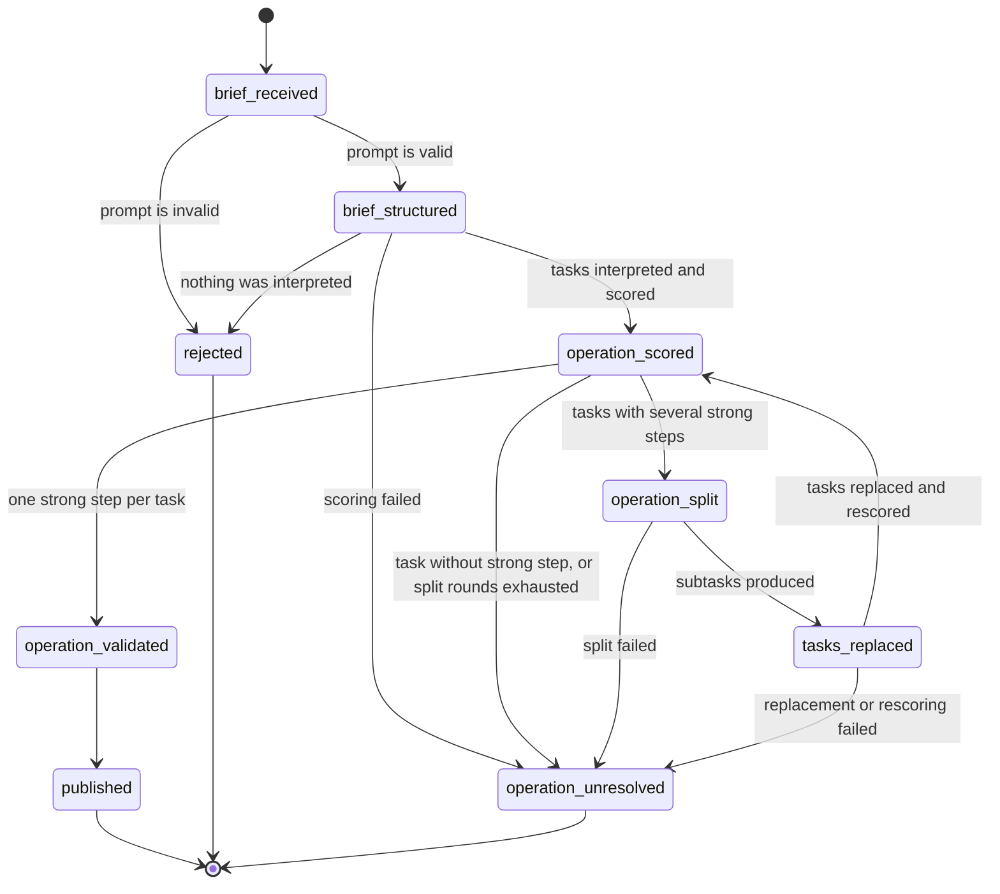
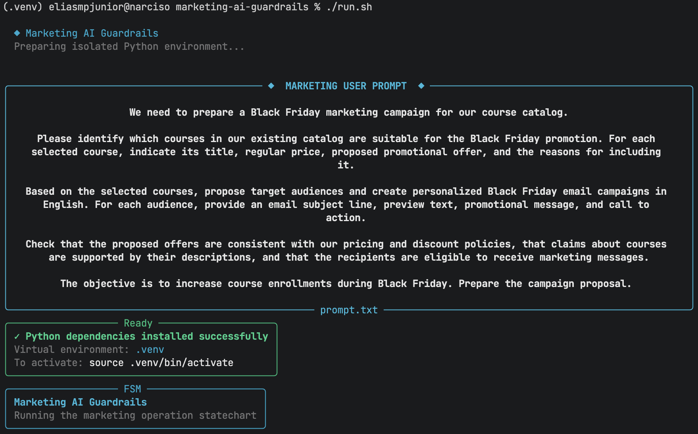
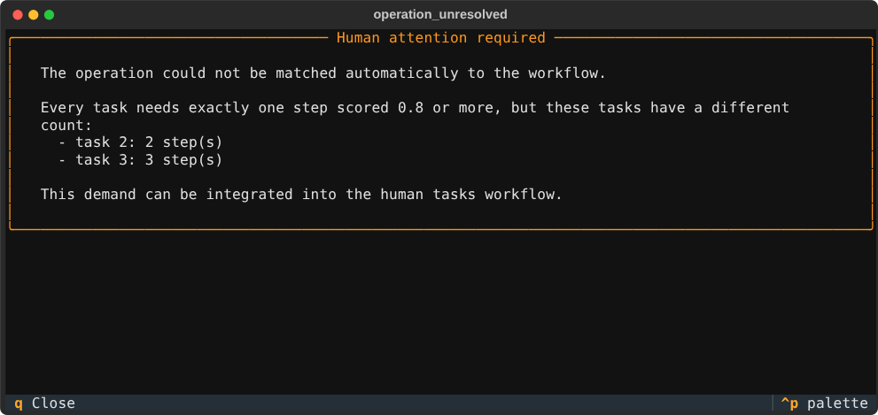

# Marketing AI Guardrails

A small, runnable exercise in designing a **validation loop** for an AI-assisted marketing workflow: what is checked and by whom, what can go wrong, and where people must step in.

## The challenge

> Please design the validation loop for a marketing use case, explain its failure modes, and identify where human oversight is required.

The marketing use case is the request in [`prompt.txt`](prompt.txt): prepare a Black Friday campaign for a course catalog. The request asks for four things:

1. Select the courses suitable for the promotion, with price, offer and reasons.
2. Propose audiences and write personalized email campaigns for them.
3. Check offers against pricing and discount policies, claims against course descriptions, and recipients against marketing consent.
4. Prepare the campaign proposal.

The scenario assumes an established marketing infrastructure: a course catalog, campaign management and existing business rules.

## What this repository demonstrates

The repository implements the **first part of that workflow end to end**, with the validation loop wrapped around the AI: understanding the request, breaking it into tasks, and tying each task to the activity of the marketing plan that performs it. The business checks of the request (pricing, claims, consent) are described under [Future steps](#future-steps) and are **not implemented**.

What runs today:

- A statechart executed with [Sismic](https://sismic.readthedocs.io/) controls the progress of a demand. It never advances because a step reported success; it advances because an independent check passed.
- The AI (Claude Code) proposes: it interprets the request into tasks, scores how close each task is to the activities of a marketing plan, and splits ambiguous tasks. Deterministic code verifies every proposal before it is used.
- Every failure ends in an explicit outcome: rejection, a bounded correction attempt, or escalation to people with an on-screen alert.
- Every run leaves a trace folder with its inputs, artifacts and the path taken through the statechart.

The AI is not turned into a deterministic component. Its outputs are placed inside an observable workflow whose progress depends on verifiable conditions.

## Approach

This is a simplified version of the methodology I developed and published in [OntoBDC](https://github.com/EliasMPJunior/ontobdc-wip). The simplification is intentional: it keeps the principles easy to follow without reproducing the full runtime.

- **States are verifiable conditions**, not labels for functions that ran. `operation_scored` means that a valid scores file exists for the current tasks.
- **Capabilities are bounded units of work** that try to establish a condition (interpret a brief, score tasks, split a task). They are interchangeable: a capability returning normally proves nothing.
- **Guards and contracts decide.** A transition fires only when its guard holds. Validation belongs to the state or transition, not to the capability that did the work, so a capability can be replaced without changing the acceptance criteria.
- **Failure paths are part of the statechart.** Correction, rejection and escalation are explicit transitions, not behavior hidden in code.
- **The plan is data.** The activities of the marketing workflow are described in an ontology, [`ontology/activities.ttl`](ontology/activities.ttl), using the existing [P-Plan](http://purl.org/net/p-plan) vocabulary: the plan says *what* should happen, the statechart controls *when* each step may proceed.

## The workflow



| State | What it establishes | Checks and capabilities |
|---|---|---|
| `brief_received` | The request is readable input. | **Guard** ([`brief_received/guard.py`](fsm/states/brief_received/guard.py)): the file exists, is UTF-8, is within the size limit, has meaningful text and no invalid control characters. |
| `brief_structured` | The request became a list of tasks, and each task was scored. | **Capability** ([`brief_received/action.py`](fsm/states/brief_received/action.py)) asks Claude Code for the tasks. **Capability** ([`brief_structured/action.py`](fsm/states/brief_structured/action.py)) verifies the tasks against their JSON contract, lists every `p-plan:Step` of the ontology with SPARQL and asks Claude Code for the three closest steps per task, with a score from 0 to 1. The answer is accepted only if it covers every task, uses distinct steps that exist in the ontology and stays within range. |
| `operation_scored` | Scores exist and can be read. | **Guard** ([`operation_scored/guard.py`](fsm/states/operation_scored/guard.py)) counts, per task, the steps scored at or above `MIN_SCORE` (0.8). It decides whether every task has exactly one, at least one, or none. |
| `operation_split` | Tasks with several strong steps were divided. | **Capability** ([`operation_split/action.py`](fsm/states/operation_split/action.py)) asks Claude Code for one subtask per strong step, and accepts the result only if it keeps the original tasks, has one subtask per strong step and references those steps. |
| `tasks_replaced` | The task list now holds the subtasks. | **Capability** ([`tasks_replaced/action.py`](fsm/states/tasks_replaced/action.py)) replaces `tasks.json`: split tasks give way to their subtasks and the other tasks are kept. The new list is scored again. |
| `operation_validated` | Every task is tied to exactly one strong step. | Contract: `is_operation_validated`. |
| `published` | End state of the implemented slice. | Requires `operation_validated`. It stands for the point where the real publication checks would begin (see [Future steps](#future-steps)); nothing is sent. |
| `rejected` | The request was refused. | Final. |
| `operation_unresolved` | People must take over. | **Capability** ([`operation_unresolved/action.py`](fsm/states/operation_unresolved/action.py)) shows an alert, with [Textual](https://textual.textualize.io/), saying what happened and that the demand can be integrated into the human tasks workflow. Final. |

## Validation loop

1. The statechart is in a state and evaluates the guards of its transitions.
2. A capability does the work needed to establish the next condition. It may call Claude Code.
3. An independent check verifies the result: a JSON contract, ontology membership, a score threshold, a count.
4. The statechart takes the transition whose guard holds: **advance**, **correct and revalidate**, **reject**, or **escalate**.

The loop is driven by verified conditions, not by the identity, confidence or success message of the capability. Correction happens in `operation_split` and `tasks_replaced`: ambiguous tasks are divided and the result is scored again, at most `max_split_rounds` times (1, set in the statechart preamble). The bound is there because the loop calls an AI; without it an ambiguous answer could keep the loop, and its cost, running forever.

## Failure modes

| What can go wrong | How it is detected | Outcome |
|---|---|---|
| Empty, unreadable, oversized or meaningless request | Guard of `brief_received` | `rejected` |
| The interpretation cannot run (Claude Code unavailable) | The capability reports failure | `rejected` |
| The AI returns something that is not the requested JSON, or no tasks | JSON contract check before scoring | `operation_unresolved`, alert |
| The AI scores steps that do not exist, repeats a step, omits a task or gives a score out of range | Verification of the scores against the ontology | Scores discarded, `operation_unresolved` |
| A task is not close to any activity of the plan | No step reaches `MIN_SCORE` | `operation_unresolved`, alert |
| A task is close to several activities (ambiguity) | More than one step reaches `MIN_SCORE` | `operation_split`, then rescored |
| The split drops or invents tasks, or does not follow the steps | Verification of the split | `operation_unresolved`, alert |
| The split does not resolve the ambiguity | Rounds exhausted | `operation_unresolved`, alert |
| The AI keeps retrying and the cost grows | `max_split_rounds` | `operation_unresolved`, alert |
| Scoring, split or replacement cannot run (Claude Code unavailable) | The capability reports failure | `operation_unresolved`, alert |

A confident score is not trusted as truth: it only chooses between paths, and only after the structure of the answer has been verified.

## Human oversight

People are required wherever the conditions themselves need judgment:

- **Today:** `operation_unresolved` is the hand-off. The alert states which tasks could not be resolved and why, and that the demand can be integrated into the human tasks workflow (see [Screenshots](#screenshots)).
- **Not automated, by design:** the threshold (`MIN_SCORE`), the number of split rounds and the ontology are rules that people own and review; the statechart enforces them but does not decide them.
- **Planned:** approval of offers and claims, adjudication of eligibility doubts and the final authorization before publication (see [Future steps](#future-steps)).

## Screenshots



*TODO: caption.*



*The alert `operation_unresolved` shows: which tasks could not be resolved and why, and that the demand can be handed to the human tasks workflow.*

## Traceability

Each run creates `trace/<timestamp>/` (ignored by Git) with:

| File | Content |
|---|---|
| `brief.txt` | The request exactly as received. |
| `tasks.json` | The tasks listing. After a split it holds the new list. |
| `step_scores.json` | The three closest steps per task, with URIs and scores. |
| `subtasks.json` | Present when tasks were split: the original tasks with their subtasks nested. |
| `path.json` | Every transition taken, with time, source, target and the facts holding afterwards, and the state the run ended in. |

## Running

```bash
./run.sh
```

The script creates a virtual environment, installs [`requirements.txt`](requirements.txt) through a Textual interface, shows the request, creates the trace folder and runs the statechart. The executor can also be run directly on a folder that contains a `brief.txt`:

```bash
python fsm/main/executor.py --etl-dir trace/<timestamp>
```

### Mocks and cost

Capabilities that call Claude Code cost tokens. While these files exist in [`mocks/`](mocks), they are used **instead of calling Claude Code**:

| Mock | Replaces |
|---|---|
| `mocks/tasks.json` | Interpretation of the request. |
| `mocks/step_scores.json` | Scoring. It also holds scores for the subtasks the split mock produces. |
| `mocks/subtasks.json` | The split of ambiguous tasks. |

With the mocks the run goes through a split and ends in `published`. To use Claude Code, remove or rename the mocks and make sure `claude` is in the `PATH`. The checks that follow each capability are the same in both modes.

## Tests

```bash
pytest
```

The suite was **written by Claude Code**. It has two parts:

- `tests/test_scenarios.py` runs the real statechart, guards and capabilities end to end, with the expected outcome of each scenario stated in advance. It covers the valid demand (split, rescored, published), a demand with one strong step per task, an invalid brief, a task without a strong step, a split that does not resolve the ambiguity, scores that name a step missing from the ontology, a tasks listing that breaks its contract, garbage and invented steps coming from Claude Code, a failing and an absent Claude Code, and the consistency of `path.json`.
- `tests/test_guards.py` tests the objective checks on their own: the inclusive threshold, the "at least one" and "exactly one" guards, unusable or missing scores, and the brief guard.

Each scenario runs in a temporary copy of `fsm/`, `ontology/` and `mocks/`, where it changes the mocks it needs. A fake `claude` executable stands in for Claude Code. The tests therefore never touch the files in `mocks/` and never spend tokens.

## Repository layout

```text
prompt.txt                     The marketing request used as input
challenge.txt                  The challenge statement
run.sh, installer.py           Environment setup and launcher
ontology/activities.ttl        The marketing plan, as P-Plan steps
fsm/main/
    marketing_operation.yaml   The statechart
    executor.py                Runs the statechart and records path.json
fsm/states/<state>/
    guard.py                   Checks that decide whether the state holds
    action.py                  The capability that works toward the state
mocks/                         Mock outputs of the AI capabilities (see above)
discussions.md                 Design decisions
tests/                         Scenario and guard tests (written by Claude Code)
docs/                          Screenshots used in this README
```

## Future steps

The rest of the request in `prompt.txt` is design work still to be built on the same pattern. Each item below is a state with its own guard and capability, placed after `operation_validated`:

- **Execute the plan.** The strong steps tied to the tasks, ordered through `p-plan:isPrecededBy`, become the sequence of capabilities to run: discover and evaluate products, select them, build offers, select the audience, generate the content.
- **Offers against policy.** A deterministic check of each proposed offer against the pricing and discount policy. A violation is rejected or corrected; it is never published on the model's word.
- **Claims against evidence.** Each statement about a course must be supported by the course description. Unsupported claims fail; ambiguous support goes to a person.
- **Consent and eligibility.** Recipients are filtered against consent records. A missing record is a failure, not a default.
- **Rule validation with SHACL.** Express the shapes of products, offers and audiences as SHACL constraints and validate the data with pySHACL, keeping the rules separate from the code that generates content.
- **Human review and authorization.** A review state for cases the rules cannot settle, and an explicit approval before anything is sent, with the reviewer's decision recorded in the trace.
- **Business scenario tests.** Extend the scenario suite with a policy violation, an unsupported claim and a case that needs human review, once those checks exist.
- **Human tasks workflow.** Replace the alert of `operation_unresolved` with an actual hand-off to the people who own the work.

## Limitations

- A structural or logical check does not establish factual truth, legal compliance or marketing effectiveness. The scores say that a task *resembles* an activity, not that the activity was done correctly.
- Nothing is published or sent; `published` marks the end of the implemented slice.
- The scoring depends on the labels of the ontology, so the quality of the plan description limits the quality of the match.
- The mocks make the demonstration reproducible but cover one scenario. The behavior with Claude Code has been exercised only in a controlled way.
- The tests cover the implemented slice only, and they exercise Claude Code through a fake executable, never the real one.
